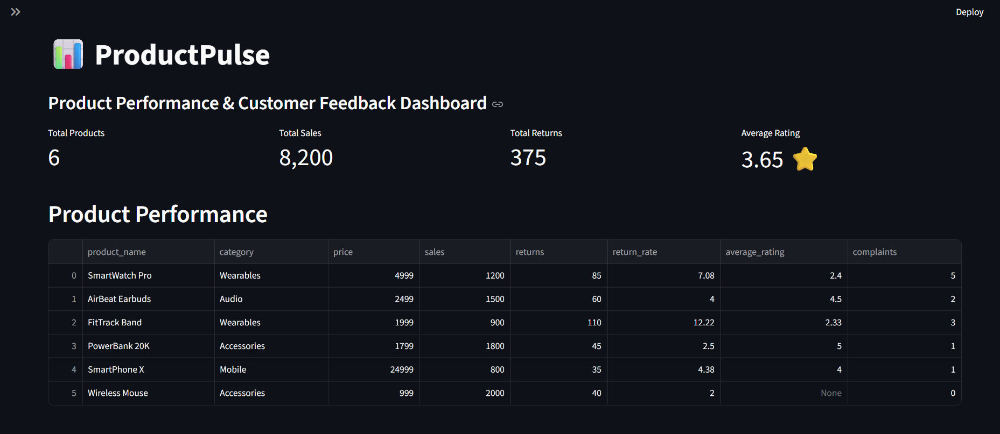
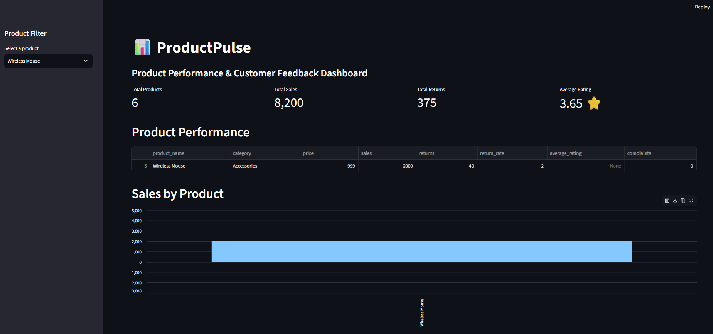
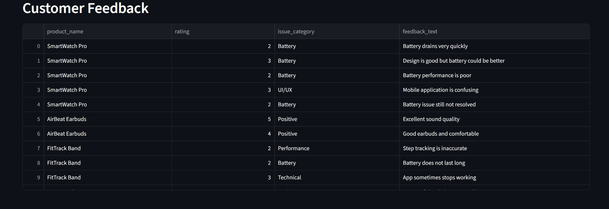

 `Product Insights`.

---

## Copy this corrected version

I recommend replacing your current README with this exact version:

```markdown
# ProductPulse 📊

ProductPulse is a product analytics dashboard built using Python, MySQL, Pandas, and Streamlit.

The project combines product performance data with customer feedback to help identify products that may require further investigation.

## 📊 Dashboard Preview

### 1. Main Dashboard



### 2. Product Performance



### 3. Customer Feedback



## 🎯 Project Objective

The objective of ProductPulse is to analyze product performance and customer feedback in one place.

The dashboard helps answer questions such as:

- Which products are performing well?
- Which products have higher return rates?
- Which products receive lower customer ratings?
- What issues are customers reporting?
- Which products may need further investigation?

## 🛠️ Technologies Used

- Python
- MySQL
- SQL
- Pandas
- Streamlit
- HTML/CSS concepts
- Git & GitHub

## 🗄️ Database Structure

The MySQL database contains three main tables:

### Products

Stores product performance information.

- Product ID
- Product name
- Category
- Price
- Sales
- Returns

### Customers

Stores basic customer information.

- Customer ID
- Customer name
- Age
- Location

### Feedback

Stores customer feedback.

- Feedback ID
- Customer ID
- Product ID
- Rating
- Feedback text
- Issue category

The tables are connected using primary keys and foreign keys.

## 🔄 Data Flow

```text
MySQL Database
      ↓
SQL JOINs
      ↓
Python
      ↓
Pandas
      ↓
Product Analysis
      ↓
Streamlit Dashboard
      ↓
Product Insights